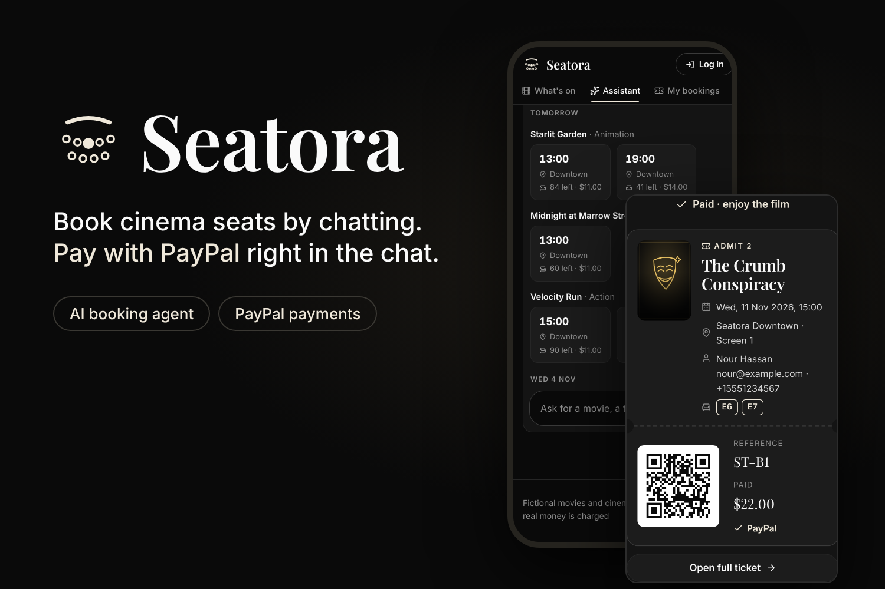
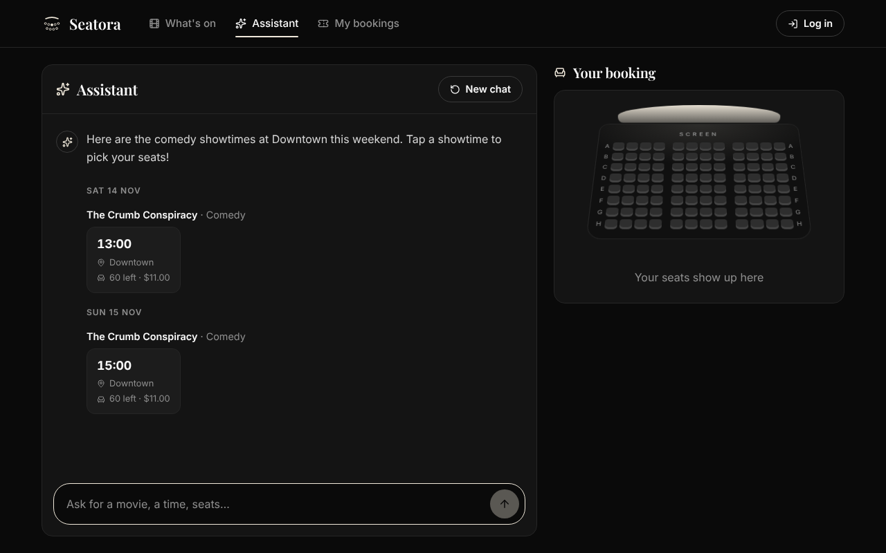
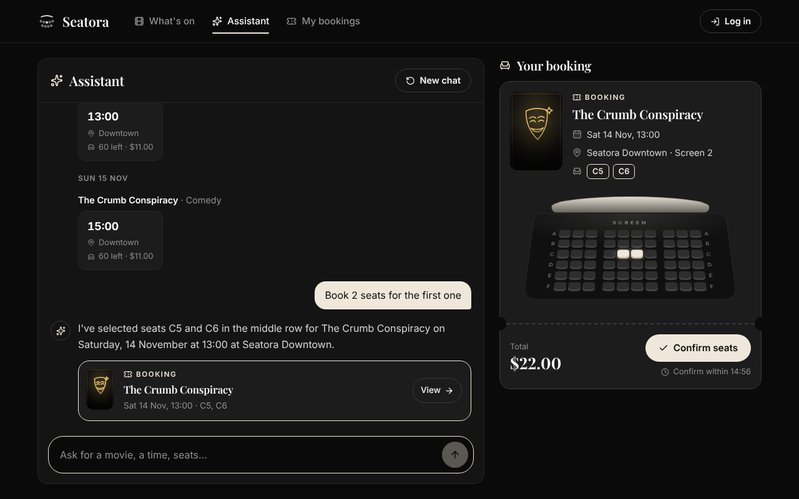
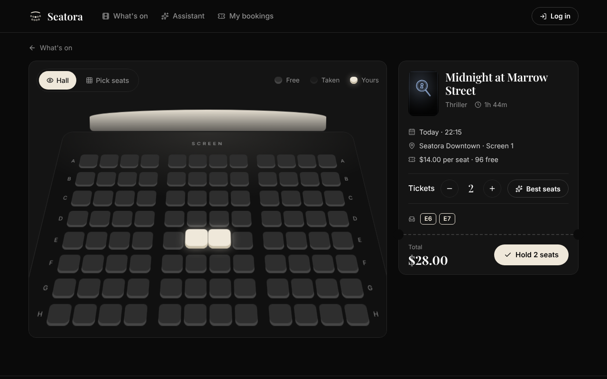
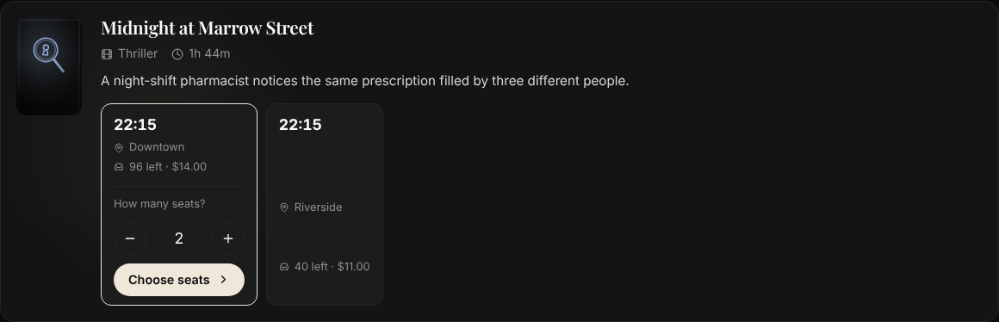
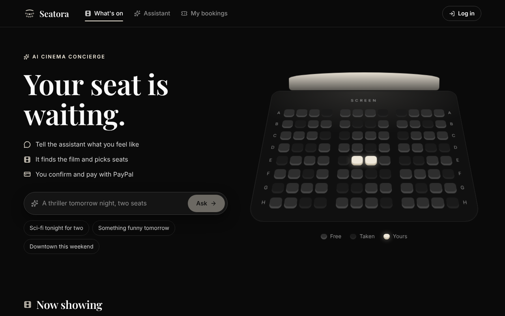

# Seatora

**Book cinema seats by chatting with an AI assistant, then pay with PayPal, without leaving the conversation.**

Live demo: **<https://seatora-web.vercel.app>** · PayPal **Sandbox**: no real money moves · all movies and cinemas are fictional.



Seatora is a cinema-booking web app with an AI booking agent. A customer types something like *"a comedy this weekend at Downtown"*. The agent searches the real schedule straight away and the chat shows the matching showtimes as time chips. The customer taps one to pick seats in a 3D hall, or asks the agent to book, which shows a booking card with the seats and a server-calculated total. One click on **Confirm** holds the seats, the PayPal button appears on the card, and once the server has verified the payment the card turns into the ticket with a QR code. Cancelling works the same way: the agent shows the refund the policy allows, the customer confirms, and the refund goes back through PayPal.

**Core rule:** the AI helps the customer decide; the backend owns seats, prices, booking states, payment verification and refunds; PayPal moves the money. Every action that holds seats, charges or refunds needs the customer's click.

| Ask the assistant | Book on the card |
| --- | --- |
|  |  |
| **Pick seats yourself** | **Or tap a time** |
|  |  |

---

## Table of Contents

- [How it works](#how-it-works)
- [The AI booking agent](#the-ai-booking-agent)
- [PayPal integration](#paypal-integration)
- [Architecture](#architecture)
- [Features](#features)
- [Tech Stack](#tech-stack)
- [Project Structure](#project-structure)
- [Getting Started](#getting-started)
- [Deploying (Vercel + MongoDB Atlas)](#deploying-vercel--mongodb-atlas)
- [Environment Variables](#environment-variables)
- [Authentication & Roles](#authentication--roles)
- [Data Model](#data-model)
- [API Reference](#api-reference)
- [Business Rules](#business-rules)
- [Request Examples](#request-examples)
- [Validation](#validation)
- [Error Handling](#error-handling)
- [Security](#security)
- [Testing](#testing)
- [Project history](#project-history)
- [Credits](#credits)

---

## How it works



1. **Ask.** "A comedy this weekend at Downtown for two." The agent searches the schedule (dates are worked out in cinema time) and the chat lists the results as time chips.
2. **Choose.** Tap a chip, say how many seats, and the 3D seat picker opens with the best seats chosen; or ask the agent to book, and it checks the seats and shows a booking card.
3. **Confirm.** One click holds the seats for 10 minutes. Visitors continue as a guest with their name, email and phone, or log in.
4. **Pay.** The PayPal button appears on the card. The server creates the order from the booking (the browser and the AI never send an amount), captures it, and checks status, amount, currency and payee before confirming.
5. **Ticket.** The card turns into the ticket: reference, seats, QR code, and a full ticket page to print or save.
6. **Cancel.** Ask the agent or use My bookings: the refund the policy allows is shown first (100% up to 24 hours before, 50% up to 2 hours before), the customer confirms, and PayPal refunds it.

## The AI booking agent

The agent (`services/agentChat.js`) is a tool-calling loop: the model chooses tools, the server runs them for the logged-in customer, and the model answers from their results.

- **Tools, from a fixed allowlist:** `searchMovies`, `searchShowtimes`, `getAvailableSeats`, `getBookingQuote`, `getMyBookings`, `getPaymentStatus`, `getCancellationQuote`, and two **propose** tools, `proposeBooking` and `proposeCancellation`, which only create a card. Nothing is held, charged or refunded until the customer clicks, and the server checks seats, price and refund again then.
- **Models:** Google **Gemini** (`gemini-3.5-flash`, then `gemini-3.8-flash`) with function calling, and **Groq** (`openai/gpt-oss-120b`, then `openai/gpt-oss-20b`) as a fallback. Failures are classified (rate limit, overloaded, too slow, unknown model, refused key, request too large); a message moves to the next model, and models that are rate limited or overloaded are skipped for a while.
- **Guards against model mistakes:** a reply that claims showtimes without searching triggers a required search; a tool call written out as text (`<proposeBooking …/>`) is turned into a required real call, and the markup is never shown; a reply that draws a fake card or button is replaced; IDs never reach the customer; showtime lists, cards and prices come only from tool results, never from the model's text.
- **Limits:** 6 tool calls and 90 seconds per message, per-user and per-visitor message limits, and a daily cap on model calls.

## PayPal integration

PayPal is the payment layer of every booking (`services/paypalService.js`, `services/captureService.js`, `services/refundService.js`):

- **Orders v2:** the server creates the order from the booking's total, in integer cents; the browser never sends an amount.
- **JS SDK buttons** on the chat's booking card and on the booking page, loaded early so they appear right after Confirm.
- **Verified capture:** the server captures and checks `COMPLETED`, amount, currency, payee and booking ownership before confirming. A payment that arrives after the hold ran out is refunded automatically and flagged for review.
- **Refunds** through the Captures refund API, for exactly the amount the customer confirmed.
- **Webhooks** (`PAYMENT.CAPTURE.COMPLETED`, `.DENIED`, `.REFUNDED`, `.REVERSED`), verified with PayPal's signature-verification API and idempotent, so duplicates and late deliveries change nothing twice.
- **Sandbox only:** the server refuses to start unless `PAYPAL_ENV=sandbox`.

## Architecture

```
Browser (React + TypeScript, served by Express)
  ├─ Chat ─────────── POST /agent/chat ──────────► Agent: Gemini → Gemini → Groq → Groq
  │                    (reply + cards + showtimes)    tool allowlist, guards, failover
  │                    POST /agent/proposals/:id/confirm   (holds seats or cancels)
  ├─ Time chips / seat picker ── POST /bookings     (hold seats for 10 minutes)
  ├─ PayPal button on the card ─ POST /payments/orders → PayPal Sandbox (customer approves)
  │                              POST /payments/capture  (server captures and verifies)
  └─ My bookings ──── GET /bookings/:id/cancellation-quote, POST /bookings/:id/cancel (PayPal refund)
PayPal ── webhooks ──► POST /payments/webhook (signature verified, idempotent)
Everything ──────────► MongoDB Atlas
```

## Features

- **AI booking agent** with tool calling, showtime chips, booking and cancellation cards, and failover from Gemini to Groq
- **PayPal checkout in the chat:** Orders v2, JS SDK buttons on the booking card, verified capture, refunds and verified webhooks (Sandbox)
- **Web app:** a dark cinema design with a CSS 3D hall, a seat picker with "Best seats", time chips that ask how many seats, a ticket with a QR code, My bookings with cancellations and refunds, a Privacy page, and a phone layout that keeps the chat above the keyboard
- **Guests:** book without an account by giving a name, email and phone; save it as an account later
- **A demo schedule that renews itself** for the coming week
- **Accounts and roles:** register/login with JWT, `CUSTOMER` and `ADMIN` roles, passwords hashed with bcrypt
- **Admin management** of cinemas, screens, movies and showtimes
- **Seat booking** with protection against double-booking (atomic `findOneAndUpdate` with `$nin` / `$addToSet`)
- **Bookings belong to users:** customers see and cancel only their own; admins manage all of them
- **Seat layouts:** screens have rows × seats per row; only seats that exist on the screen can be booked
- **Server-side pricing:** `totalPrice` = showtime price × number of seats
- **Seats stay in sync:** cancelling, changing seats or moving a booking frees and reserves seats correctly
- **No overlapping showtimes** on a screen (movie length + 15-minute break)
- **Seat holds:** unpaid (`pending`) bookings hold their seats for 10 minutes, then expire and free them
- **Safe deletes:** blocked while active bookings exist; otherwise dependent records are removed too
- **Pagination, filters and sorting** on every list endpoint
- **Partial updates** with `PUT`: send only the fields you change
- **Two validation layers** (request + Mongoose) and request bodies limited to allowed fields
- **Consistent error responses** with the right status codes (400 / 401 / 403 / 404 / 409 / 429)
- **Security:** helmet headers, CORS, a general rate limit plus a stricter one on login/register, at most 10 seats per customer per showtime
- **Assistant tools:** a fixed allowlist of read tools and two "propose" tools that only create a card; the customer's click confirms it, after the server re-checks seats, price or refund
- **Automated test suite** against an in-memory MongoDB

## Tech Stack

| Layer      | Technology                                        |
| ---------- | ------------------------------------------------- |
| Runtime    | Node.js (ES modules)                              |
| Framework  | Express 5                                         |
| Web app    | React 19, TypeScript, Vite, Lucide icons          |
| AI         | Google Gemini (`@google/genai`, function calling), Groq (OpenAI-style API through `fetch`) |
| Payments   | PayPal REST APIs (Orders v2, Captures, Refunds, Webhooks) and JS SDK, Sandbox |
| Hosting    | Vercel, MongoDB Atlas                             |
| Database   | MongoDB                                           |
| ODM        | Mongoose 9                                        |
| Auth       | jsonwebtoken, bcryptjs                            |
| Security   | helmet, cors, express-rate-limit                  |
| Config     | dotenv                                            |
| Dev server | `node --watch` (built into Node)                  |
| Testing    | Node test runner, supertest, mongodb-memory-server |

## Project Structure

```
.
├── frontend/                 # The customer web app (React + TypeScript, Vite), built into public/
├── server.js                 # Entry point: loads .env, connects to MongoDB, starts listening
├── app.js                    # Express app: security middleware, routes, 404 + error handler (Vercel's entry)
├── vercel.json               # Vercel install and build commands
├── config/
│   └── db.js                 # MongoDB connection (at startup, or on first request on Vercel); reports failed index builds
├── models/                   # Mongoose schemas
│   ├── User.js
│   ├── cinema.js
│   ├── screens.js
│   ├── movies.js
│   ├── showTime.js
│   ├── Booking.js
│   ├── Payment.js            # PayPal order / capture record per booking
│   ├── WebhookEvent.js       # PayPal webhook events already handled
│   ├── RateLimit.js          # Rate-limit counts, shared by every instance
│   ├── AgentProposal.js      # Booking / cancellation cards waiting for the customer's click
│   └── AgentConversation.js  # Each customer's or visitor's assistant conversation
├── services/
│   ├── bookingService.js     # Quote, hold, cancellation rules shared by the API and the assistant
│   ├── showtimeService.js    # Showtime search shared by the API and the assistant
│   ├── agentTools.js         # The assistant's allowlisted tools
│   ├── agentChat.js          # One chat turn: model, tool calls, limits, history
│   ├── geminiClient.js       # Gemini through Google's SDK (replaceable in tests)
│   ├── proposalService.js    # Confirming a proposal card (re-checks everything)
│   ├── guestService.js       # Guest accounts: create, keep, upgrade
│   ├── visitorService.js     # Moving a visitor's chat and cards to their account at login
│   ├── paypalService.js      # PayPal Sandbox client (token, create order, capture, refund)
│   ├── captureService.js     # Checks and records a capture (endpoint and webhook)
│   └── refundService.js      # The one refund routine used by every refund
├── controllers/              # Route handlers (business logic), incl. paymentController.js
├── routes/                   # Express routers, one per resource, incl. paymentRouter.js
├── validators/               # Per-resource request-body schemas, incl. paymentValidator.js
├── middlewares/
│   ├── auth.js               # protect (login required), restrictTo (role check)
│   ├── validateRequest.js    # Schema-driven body validator; strips unknown fields
│   ├── validateObjectId.js   # Rejects malformed :id params with 400
│   ├── rateLimit.js          # Limits failed login/register attempts
│   └── errorHandler.js       # Global error handler
├── utils/
│   ├── AppError.js           # Operational error class (message + HTTP status)
│   ├── catchAsync.js         # Forwards async errors to the error handler
│   ├── seatLayout.js         # Seat checks against a screen's layout
│   ├── cascade.js            # Delete rules for showtimes and their bookings
│   ├── timezone.js           # Local cinema time <-> UTC conversion
│   ├── showtimeSeats.js      # Atomic seat reserve / release on a showtime
│   ├── bookingHolds.js       # Hold deadlines and expiry of unpaid bookings
│   ├── cancellationPolicy.js # Refund percentage by time before the show
│   ├── listQuery.js          # Pagination, filters, list responses
│   └── rateLimitStore.js     # Keeps rate-limit counts in MongoDB
├── scripts/
│   ├── seedAdmin.js          # Creates the first admin account
│   ├── seedDemo.js           # Adds the fictional demo catalogue
│   ├── seedProduction.js     # Seeds the deployed database from .env.production
│   └── demoCatalogue.js      # The demo cinemas, movies and showtime plan
└── tests/                    # Automated tests (npm test)
```

Each request passes through: **helmet → CORS → router → `protect` / `restrictTo` (when required) → `validateObjectId` (for `/:id`) → validator → controller → `errorHandler`** (on failure).

## Getting Started

### Prerequisites

- Node.js 22 or newer
- A MongoDB instance: local, Docker, or MongoDB Atlas

### Installation

```bash
git clone https://github.com/kenzyahmed1402/Seatora.git
cd Seatora
npm install
```

### Run MongoDB locally (optional, Docker)

```bash
docker run -d --name cinema-mongo -p 27017:27017 mongo:7
```

### Configure

Copy the template and fill in your values:

```bash
cp .env.example .env
```

```env
MONGO_URI=mongodb://localhost:27017/cinema-booking
PORT=5050
NODE_ENV=development
JWT_SECRET=<output of: openssl rand -hex 32>
JWT_EXPIRES_IN=7d
PAYPAL_ENV=sandbox
ADMIN_EMAIL=admin@cinema.com
ADMIN_PASSWORD=<choose a password, at least 12 characters>
```

### Create the admin account (once per database)

```bash
node scripts/seedAdmin.js
```

### Add demo data (optional)

```bash
npm run seed:demo              # adds the catalogue if the database has none
npm run seed:demo -- --reset   # replaces the catalogue (refused in production or while bookings exist)
```

Adds a fictional catalogue: 3 cinemas with 2 screens each, 8 original movies, and showtimes for the next 7 days between 13:00 and 22:30 cinema time (`CINEMA_TZ`). Prices are $8–$16 per seat, with an evening surcharge from 17:00. Users and bookings are never changed.

The schedule keeps itself filled: when showtimes are listed or the assistant searches them, the server plans the next 7 days again in the same way, at most once an hour (`services/showtimeSchedule.js`). A screen only gets showtimes on a day it has none, so nothing added by hand is overlapped or doubled. This uses only the demo cinemas and movies, found by name; any other catalogue is left alone. Set `SHOWTIME_AUTOFILL=off` to turn it off.

### Start the server

```bash
npm run dev          # with auto-reload (node --watch)
# or
npm start            # plain start
```

The server connects to MongoDB first, then logs `Server running on port 5050` (or your `PORT`).

### Web app (React)

The customer web app lives in `frontend/` (React + TypeScript, built with Vite). Pages use addresses after `#` (e.g. `/#/bookings`), so the server only serves one page and page addresses never clash with API paths.

Anyone can browse what's on and talk to the assistant without an account. Booking, paying, cancelling and My bookings open a dialog to log in, create an account or continue as a guest. The home page opens on a 3D preview of a cinema hall, drawn with CSS 3D transforms (no 3D library), so it stays smooth on slow phones and stands still for visitors who turn motion off. The Assistant page (`/#/chat`) is the conversation with the Seatora assistant: the booking and cancellation cards it proposes appear as tickets, with a small 3D hall showing the proposed seats. Pressing Confirm asks a visitor to log in or continue as a guest first; nothing is held or cancelled before that. The assistant's replies are shown as text with simple formatting (paragraphs, lists, bold), never as raw HTML. Each showtime has its own page (`/#/showtime/<id>`) with a 3D seat picker: choose how many tickets, the best free seats together near the centre are suggested, and tapping a seat tilts the camera down over the hall to pick by hand. Holding the seats asks a visitor to log in or continue as a guest; the server checks the seats and works out the price. The home page filters showtimes by genre and cinema. Holding seats opens the booking page (`/#/booking/<id>`): the order with a countdown of the seat hold and PayPal's button (PayPal's script is loaded only on this page). The server creates the PayPal order from the booking, so the browser never sends an amount, and confirms the booking only after it has captured the payment and checked PayPal's answer. Once paid, the page turns into the ticket: a reference (e.g. `ST-18293A4B`) and a QR code linking to the booking page, which only its owner can open. The ticket can be printed or saved as a PDF (only the ticket prints) or saved as a PNG image drawn in the browser. A guest is offered to save the booking by turning the guest account into a normal one (`POST /auth/upgrade`). The QR code is made with `qrcode-generator` (MIT licence). My bookings (`/#/bookings`) lists the customer's bookings in two tabs: Upcoming (paid, unpaid and in-review bookings for shows still ahead, soonest first) and Past (everything else). A paid booking opens its ticket or is cancelled through a dialog that shows the refund under the policy before anything happens; an unpaid one is paid or its seats released. The movies are fictional, so their posters are line-art drawings made for this project (one symbol and colour per genre, in `frontend/src/components/genreArt.tsx`). The fonts (Playfair Display and Inter; SIL Open Font License) and the icons (Lucide; ISC licence) are bundled with the app, so no third-party service is called. Showtimes are shown in the cinemas' time zone, `Africa/Cairo` unless `VITE_CINEMA_TZ` is set at build time.

```bash
npm --prefix frontend ci       # once
npm run dev                    # terminal 1: the API on http://localhost:5050
npm --prefix frontend run dev  # terminal 2: the app on http://localhost:5173 (API calls are passed to :5050)
```

`npm run build` type-checks and builds the app into `public/` (not committed). Vercel runs it on every deploy; Express serves `public/` on every host, with helmet's security headers (a Content Security Policy that allows the site's own scripts plus PayPal's checkout script, frames and images, and nothing else from outside; and a cross-origin opener policy of `same-origin-allow-popups`, so PayPal's popup can report back to the page) and a one-year cache for the content-hashed files in `public/assets/`.

### Run the tests

```bash
npm test
```

## Deploying (Vercel + MongoDB Atlas)

The app runs on Vercel as a single function (Vercel detects the Express app in `app.js`), with a MongoDB Atlas database. `server.js` doesn't run there: when `VERCEL` is set, `app.js` checks the settings as it loads and connects to the database on the first request. Seat holds still expire without the background sweeper, because every route that reads or books seats expires overdue holds first.

1. **Atlas:** create a separate database for the deployed app (e.g. `seatora-prod`) and a database user with *readWrite* on that database only and a long generated password. Under **Network Access**, allow `0.0.0.0/0`: Vercel has no fixed IP addresses, so the password protects the database.
2. **Vercel:** **Add New → Project**, import this repository. Leave the framework, build and output settings as detected; `vercel.json` sets the install command (`npm ci --omit=dev`).
3. **Environment variables** (in Vercel's settings only, never in the repository), for the Production environment: `MONGO_URI` (the deployed database), `JWT_SECRET` (a new one from `openssl rand -hex 32`), `NODE_ENV=production`, `TRUST_PROXY=1`, `PAYPAL_ENV=sandbox`, `PAYPAL_CLIENT_ID`, `PAYPAL_CLIENT_SECRET`, `GEMINI_API_KEY`, and optionally `PAYPAL_MERCHANT_ID`, `CINEMA_TZ`, `GEMINI_MODEL`, `AI_DAILY_REQUEST_CAP` and `AI_USER_MESSAGE_LIMIT`.
4. **Production branch:** Vercel serves the production URL from the branch set under **Settings → Environments → Production** (default `main`). Deployments of other branches are previews behind a Vercel login, which PayPal's webhooks can't reach.
5. **Function region:** under **Settings → Functions**, pick the region closest to the Atlas cluster.
6. Deploy, then check that `https://<your-project>.vercel.app/health` returns `{"status":"ok","database":"connected"}`. If the settings are incomplete, the function logs say which ones.
7. **Seed the deployed database** from your computer. Copy the template, fill in `.env.production` with an editor (it is gitignored), then run the seed:

   ```bash
   cp .env.production.example .env.production
   npm run seed:prod
   ```

   It adds the demo catalogue (only if the database has none) and the admin account, reading only `.env.production`. It refuses a connection string without a database name, or one pointing at the same database as your local `.env`.
8. **PayPal webhook:** in the PayPal Developer Dashboard (Sandbox), add a webhook to your app for `https://<your-project>.vercel.app/payments/webhook` with the events *Payment capture completed*, *denied*, *refunded* and *reversed*. Put its ID in Vercel as `PAYPAL_WEBHOOK_ID` and redeploy.

## Environment Variables

| Variable          | Required    | Default            | Description                                                                 |
| ----------------- | ----------- | ------------------ | --------------------------------------------------------------------------- |
| `MONGO_URI`       | Yes         | —                  | MongoDB connection string. The server won't start without it, and exits if the connection fails. |
| `JWT_SECRET`      | Yes         | —                  | Secret used to sign login tokens, at least 32 characters. Keep it private. The server won't start without it. |
| `PAYPAL_ENV`      | Yes         | —                  | Must be `sandbox`. The server won't start with any other value, so it can never use live PayPal. |
| `PAYPAL_CLIENT_ID` / `PAYPAL_CLIENT_SECRET` | For payments | — | Credentials of a PayPal Sandbox REST app. Set both or neither. |
| `PAYPAL_WEBHOOK_ID` | For payments | —                | ID of the Sandbox webhook, used to verify incoming PayPal events.            |
| `PAYPAL_MERCHANT_ID` | No          | —                  | Your Sandbox business account's merchant ID. When set, a payment only counts if PayPal says the money went to this account. |
| `PORT`            | No          | `5050`             | HTTP port.                                                                  |
| `JWT_EXPIRES_IN`  | No          | `7d`               | How long a login token stays valid.                                         |
| `NODE_ENV`        | No          | —                  | Set to `development` locally to get stack traces in error responses. Anything else, including unset, gives safe responses (see [Error Handling](#error-handling)). |
| `CORS_ORIGIN`     | No          | any origin         | Comma-separated frontend URLs allowed to call the API from a browser.       |
| `AUTH_RATE_LIMIT` | No          | `10`               | Failed login/register attempts allowed per IP per 15 minutes.               |
| `HOLD_MINUTES`    | No          | `10`               | How long an unpaid booking holds its seats, 1–60. The server won't start with another value. |
| `API_RATE_LIMIT`  | No          | `300`              | Requests allowed per IP per 15 minutes across the whole API.                |
| `TRUST_PROXY`     | No          | `0`                | Number of proxies in front of the app when hosted (e.g. `1` on Vercel or Render). |
| `CINEMA_TZ`       | No          | `Africa/Cairo`     | The cinemas' time zone (IANA name), used to plan demo showtimes in local time. |
| `GEMINI_API_KEY`  | For the assistant | —            | Gemini API key (Google AI Studio). Without it `POST /agent/chat` answers `503`; everything else works. |
| `GEMINI_MODEL`    | No          | `gemini-3.5-flash` | The Gemini model the assistant uses.                                         |
| `GEMINI_FALLBACK_MODEL` | No    | `gemini-3.8-flash` | Used for a message when the first model fails (rate limit, overloaded, too slow) or is cooling down after a rate limit. |
| `GROQ_API_KEY`    | No          | —                  | Groq API key (console.groq.com). When set, Groq's models answer when Gemini can't. |
| `GROQ_MODELS`     | No          | `openai/gpt-oss-120b,openai/gpt-oss-20b` | The Groq models tried after Gemini's, in order.               |
| `AI_DAILY_REQUEST_CAP` | No     | `200`              | Model calls allowed per day across all users, to protect the API quota.     |
| `AI_USER_MESSAGE_LIMIT` | No    | `30`               | Messages to the assistant per user per hour.                                 |
| `AI_VISITOR_MESSAGE_LIMIT` | No | `10`               | Messages to the assistant per hour from one network for visitors who haven't logged in. |
| `GUEST_ACCOUNT_LIMIT` | No      | `10`               | Guest accounts that one network can create per hour.                         |
| `SHOWTIME_AUTOFILL` | No        | on                 | `off` stops the demo schedule from planning the next 7 days by itself.       |
| `SIGNUP_RATE_LIMIT` | No        | `10`               | New accounts (register, or a guest saving their account) that one network can create per hour. |
| `ADMIN_NAME`      | No          | `Admin User`       | Used by `scripts/seedAdmin.js`.                                             |
| `ADMIN_EMAIL`     | No          | `admin@cinema.com` | Used by `scripts/seedAdmin.js`.                                             |
| `ADMIN_PASSWORD`  | For seeding | —                  | Used by `scripts/seedAdmin.js`; at least 12 characters, or the script refuses to run. |

## Authentication & Roles

| Role       | How it's created                                         | Can do                                                        |
| ---------- | -------------------------------------------------------- | ------------------------------------------------------------- |
| `CUSTOMER` | `POST /auth/register` (a requested role is ignored)      | Browse, book seats, view **their own** bookings and cancel unpaid ones    |
| `ADMIN`    | Only with `node scripts/seedAdmin.js`                    | Everything, including managing all bookings                   |

Register or log in to get a token, then send it with every request that needs a login:

```
Authorization: Bearer <token>
```

**Guests:** `POST /auth/guest { name, email, phone }` creates a temporary account for the person the booking is for and logs it in through the cookie. The name follows the sign-up rules, the email must be reachable, and the phone needs 7–15 digits, optionally after `+` (spaces, dashes, dots and brackets are removed). The email and phone are saved as contact details and copied onto each booking (`customerName`, `customerEmail`, `customerPhone`), and the ticket shows them. The email is never a login: the account itself gets a random email on the unreachable `.invalid` domain and a random password nobody sees, so it can't clash with an existing account. Only guests actually created count toward `GUEST_ACCOUNT_LIMIT`. The guest form links to a **Privacy** page (`#/privacy`, also in the footer) that says what's collected, why, who else is involved (PayPal gets only the booking's reference and amount; the AI services get only chat messages, never the guest's details), how long it's kept and which cookies are used. An unused guest account is deleted after 7 days; one that books is kept, and `POST /auth/upgrade` turns it into a normal account with the guest's own name, email and password, keeping its bookings.

**Visitors** who haven't logged in can browse and chat with the assistant: their chat is kept under a random ID in a `seatora_visitor` cookie (HTTP-only, a day long) and moves to their account, with its cards, when they log in, register or continue as a guest. Confirming a card, booking, paying and cancelling always need a login.

Browsers don't need the header: login and register also set a `seatora_session` cookie that is **HTTP-only** (page scripts can't read it), **Secure** (HTTPS only, except with `NODE_ENV=development` on localhost) and **SameSite=Strict** (other sites' pages can't send it, which also blocks cross-site request forgery). It expires with the token. `POST /auth/logout` deletes it. When both are sent, the Bearer header wins.

| Situation                         | Response |
| --------------------------------- | -------- |
| No token                          | `401`    |
| Invalid, tampered or expired token | `401`   |
| Logged in, but not allowed        | `403`    |

## Data Model

```
Cinema 1 ──── * Screen 1 ──── * Showtime * ──── 1 Movie
                                   1
                                   │
                                   *
                 User 1 ──── *  Booking
```

All documents have `createdAt` / `updatedAt` timestamps.

### User

| Field      | Type   | Rules                                                  |
| ---------- | ------ | ------------------------------------------------------ |
| `name`     | String | required, max 100 chars                                |
| `email`    | String | required, unique, valid email, max 254 chars, stored lowercase |
| `password` | String | required, 8 chars to 72 bytes, hashed, never returned  |
| `role`     | String | `CUSTOMER` (default) or `ADMIN`                        |

Signing up (`POST /auth/register`, `POST /auth/upgrade`) adds these rules, in `utils/accountRules.js`:

- **Name:** 2–50 characters after extra spaces are removed; letters of any one alphabet (with accents), with a space, hyphen, apostrophe or full stop between words; no digits or symbols. Names that pass for the cinema or its staff are refused, such as `Admin`, `Seatora Support` or `Guest`, including look-alike spellings (`A d-m í n`, Cyrillic `Аdmin`, fullwidth `ａｄｍｉｎ`).
- **Email:** not a `.invalid` address (guest accounts use `@guest.invalid`).
- **Password:** not a common password, not the email or name, and at least 4 different characters.

Login only checks the shape of the email and password, so older accounts can still log in.

### Cinema

| Field      | Type   | Rules                       |
| ---------- | ------ | --------------------------- |
| `name`     | String | required, max 100 chars     |
| `location` | String | required, max 200 chars     |

### Screen

| Field          | Type     | Rules                                                     |
| -------------- | -------- | --------------------------------------------------------- |
| `cinema`       | ObjectId | required, ref `Cinema` (must exist)                       |
| `screenNumber` | Number   | required, ≥ 1, unique per cinema                          |
| `rows`         | Number   | 1–26 (rows `A`–`Z`)                                       |
| `seatsPerRow`  | Number   | 1–99                                                      |
| `capacity`     | Number   | calculated by the server: `rows × seatsPerRow`            |

Example: `rows: 10, seatsPerRow: 12` → seats `A1` to `J12`, capacity 120.

### Movie

| Field         | Type   | Rules                                                                                  |
| ------------- | ------ | -------------------------------------------------------------------------------------- |
| `title`       | String | required, max 200 chars                                                                |
| `genre`       | String | required, one of `Action`, `Comedy`, `Drama`, `Horror`, `Sci-Fi`, `Romance`, `Animation`, `Thriller` |
| `duration`    | Number | required, minutes, 1–600                                                               |
| `description` | String | optional, max 2000 chars                                                               |
| `language`    | String | optional, default `English`                                                            |
| `releaseDate` | Date   | optional                                                                               |

### Showtime

| Field            | Type     | Rules                                                                 |
| ---------------- | -------- | --------------------------------------------------------------------- |
| `movie`          | ObjectId | required, ref `Movie` (must exist)                                    |
| `screen`         | ObjectId | required, ref `Screen` (must exist)                                   |
| `startTime`      | Date     | required; can't overlap another showing on the same screen            |
| `price`          | Number   | required, ≥ 0, price per seat                                         |
| `bookedSeats`    | [String] | managed by the server from the bookings; can't be set through the API |
| `availableSeats` | virtual  | `screen.capacity - bookedSeats.length` (only when `screen` is populated) |

### Booking

| Field           | Type     | Rules                                                        |
| --------------- | -------- | ------------------------------------------------------------ |
| `user`          | ObjectId | set by the server from the login token                       |
| `showtime`      | ObjectId | required, ref `Showtime` (must exist)                        |
| `customerName`  | String   | set by the server from the user's account                    |
| `customerEmail` | String   | set by the server from the user's account                    |
| `seats`         | [String] | required, 1–10 seats, no duplicates, codes like `A1` or `B12` (`/^[A-Z][1-9]\d?$/`), must exist on the screen |
| `totalPrice`    | Number   | calculated by the server: showtime price × seats, rounded to cents |
| `status`        | String   | `pending` (always on creation), `confirmed`, `cancelled`, `expired`, `refunded` or `needs_review` |
| `holdExpiresAt` | Date     | set by the server: when a `pending` booking gives its seats back (creation + `HOLD_MINUTES`) |

### Payment

One record per PayPal order. Created and updated by the [payment endpoints](#payments).

| Field           | Type     | Rules                                                        |
| --------------- | -------- | ------------------------------------------------------------ |
| `booking`       | ObjectId | required, ref `Booking`                                      |
| `user`          | ObjectId | required, ref `User`                                         |
| `paypalOrderId` | String   | required, **unique**                                         |
| `captureId`     | String   | **unique** once set                                          |
| `amountCents`   | Number   | required, whole cents (`2500` = $25.00)                      |
| `currency`      | String   | required, 3-letter code, e.g. `USD`                          |
| `refundId`      | String   | PayPal's refund ID, **unique** once set                      |
| `refundCents`   | Number   | the amount refunded or being refunded, whole cents           |
| `status`        | String   | `created`, `captured`, `failed`, `refund_pending`, `refunded` or `needs_review` |

The unique order and capture IDs mean a repeated request or webhook can never record, confirm or refund the same payment twice.

### PayPal client

`services/paypalService.js` talks to PayPal from the server only:

- **Sandbox only:** the PayPal address (`https://api-m.sandbox.paypal.com`) is fixed in code, not a setting, and the server refuses to start unless `PAYPAL_ENV=sandbox`.
- **Access token:** fetched with `PAYPAL_CLIENT_ID` / `PAYPAL_CLIENT_SECRET` and reused until a minute before it expires. Without credentials, payment calls answer `503`.
- **Create order:** for the amount the server calculated, with the booking ID stored on the order.
- **Capture:** returns what PayPal reports (status, capture ID, amount, currency, payee) for the server to check against the booking. The client itself never marks anything as paid.
- **Idempotent:** calls can carry a `PayPal-Request-Id`, so repeating one returns the first result instead of charging twice.
- **No leaks:** errors carry PayPal's status, error name and debug ID only, never credentials, tokens or request bodies. Requests time out after 15 seconds.

## API Reference

All request and response bodies are JSON. Dates are ISO 8601 in UTC.

### Endpoints

Access: **Public** = no login · **Logged in** = any user · **Admin** = admin only.

| Resource  | Base path    | `GET` (list / one) | `POST`    | `PUT`                  | `DELETE` | Populated on read              |
| --------- | ------------ | ------------------ | --------- | ---------------------- | -------- | ------------------------------ |
| Cinemas   | `/cinemas`   | Public             | Admin     | Admin                  | Admin    | —                              |
| Screens   | `/screens`   | Public             | Admin     | Admin                  | Admin    | `cinema`                       |
| Movies    | `/movies`    | Public             | Admin     | Admin                  | Admin    | —                              |
| Showtimes | `/showTimes` | Public             | Admin     | Admin                  | Admin    | `movie`, `screen` → `cinema`   |
| Bookings  | `/bookings`  | Logged in (own; admin: all) | Logged in | Logged in (customer: cancel own unpaid only) | Admin (not paid bookings) | `showtime` → `movie`, `screen` |

| Method | Path             | Access    | Description                         |
| ------ | ---------------- | --------- | ----------------------------------- |
| `POST` | `/auth/register` | Public    | Create a customer account, returns a token |
| `POST` | `/auth/login`    | Public    | Log in, returns a token             |
| `POST` | `/auth/guest`    | Public    | Continue as a guest: creates a temporary account and logs it in (10 per network per hour) |
| `POST` | `/auth/upgrade`  | Logged in (guest) | Turn the guest account into a normal one, keeping its bookings. Body: `name`, `email`, `password` |
| `POST` | `/auth/logout`   | Public    | Delete the browser's login cookie   |
| `GET`  | `/auth/me`       | Logged in | The current user                    |

| Method | Path      | Access | Description                         |
| ------ | --------- | ------ | ----------------------------------- |
| `GET`  | `/health` | Public | `200 {"status":"ok","database":"connected"}`, or `503` while the database is unreachable. Not rate limited, for hosting health checks. |

| Method | Path                | Access    | Description                                                   |
| ------ | ------------------- | --------- | ------------------------------------------------------------- |
| `GET`  | `/showTimes/:id/seats` | Public | Seat map: `rows`, `seatsPerRow`, `capacity`, `taken` seats, `available` count, `price` |
| `POST` | `/bookings/quote`   | Logged in | Price of seats without reserving them. Body: `showtime`, `seats`. Same checks as booking; answers `totalPrice` and `totalCents` |
| `GET`  | `/payments/config`  | Public    | The PayPal client ID and currency the web app needs to show PayPal's button. The client ID is public by design; the secret is never sent |
| `POST` | `/payments/orders`  | Logged in | Start PayPal checkout for your own pending booking. Body: `booking` |
| `POST` | `/payments/capture` | Logged in | Take the payment after you approved it in PayPal. Body: `orderId` |
| `GET`  | `/payments/:id`     | Logged in | Your own payment (admins: any)                                |
| `POST` | `/payments/:id/refund` | Admin  | Refund a `needs_review` payment in full                       |
| `POST` | `/payments/webhook` | PayPal (signature checked) | PayPal's event notifications, see [Webhooks](#paypal-webhooks) |
| `GET`  | `/bookings/:id/cancellation-quote` | Logged in | What cancelling your paid booking refunds right now |
| `POST` | `/bookings/:id/cancel` | Logged in | Cancel your paid booking with a refund. Body: `{ "confirm": true, "expectedRefundCents"?: number }` |
| `POST` | `/agent/chat` | Public | One message to the booking assistant (visitors too). Body: `message` (1–1000 characters). Answers `reply` and `cards` |
| `GET`  | `/agent/chat` | Public | Your conversation as shown on screen |
| `DELETE` | `/agent/chat` | Public | Start a new conversation |
| `GET`  | `/agent/proposals/:id` | Public | One of your own proposal cards and its status |
| `POST` | `/agent/proposals/:id/confirm` | Logged in | Confirm your own proposal card, see [Assistant tools](#assistant-tools-and-proposals) |

See [Payments](#payments) for the rules.

> `PUT` accepts partial updates: send only the fields you want to change.

### Payments

All payments go through the PayPal **Sandbox**. The browser never sends an amount, and a booking becomes `confirmed` only after the server has checked the capture with PayPal.

**`POST /payments/orders { booking }`**

- The booking must be yours (`404` otherwise), `pending`, and its hold must not have run out (`409`).
- The amount is the booking's `totalPrice`, in cents. Asking again for the same booking returns the same order (`200`) instead of creating a second one.
- Once an order exists, the booking's seats and showtime can't be changed (`409`), so the price the customer saw stays the price charged.
- Answers `201` with the payment; its `paypalOrderId` goes to the PayPal checkout button.

**`POST /payments/capture { orderId }`**

1. Before any money moves, the booking must still be `pending` with time left on its hold. The hold is then stretched to at least 2 minutes so it can't run out mid-capture. If the hold has run out, nothing is captured, the payment becomes `failed` and the answer is `409`.
2. PayPal captures the order. The request carries a fixed request ID, so a retry never charges twice.
3. The result must be a `COMPLETED` capture of exactly the payment's amount, currency and booking (and payee, if `PAYPAL_MERCHANT_ID` is set).
4. Only then does the payment become `captured` and the booking `confirmed`. Both changes are conditional, so simultaneous or repeated requests can't confirm twice; repeating a successful capture just returns the result (`200`).

| What happened                                      | Payment        | Booking                | Answer |
| -------------------------------------------------- | -------------- | ---------------------- | ------ |
| Verified capture                                   | `captured`     | `confirmed`            | `200`  |
| Hold ran out before capture                        | `failed`       | `expired`              | `409`  |
| PayPal declined the payment                        | `created`      | `pending` (retry possible) | `422` |
| PayPal unreachable                                 | `created`      | `pending`              | `502`  |
| Capture doesn't match (amount, currency, booking, status) | `needs_review` | `needs_review` (keeps seats) | `409` |
| Booking cancelled while PayPal was capturing       | `refunded` (in full, automatically; `needs_review` if that fails) | `cancelled` | `409` |

`needs_review` means money may have been taken without a valid booking. An admin refunds it in full with `POST /payments/:id/refund`, which also frees the booking's seats if it was held for review.

### Cancelling a paid booking

The policy, in `utils/cancellationPolicy.js`, is the only place the refund rules live:

| Time before the show | Refund                 |
| -------------------- | ---------------------- |
| 24 hours or more     | 100%                   |
| 2 to 24 hours        | 50% (odd cents rounded down) |
| Less than 2 hours    | can't be cancelled     |

- **`GET /bookings/:id/cancellation-quote`** shows what cancelling would refund right now, calculated by the server: `allowed`, `refundPercent`, `refundCents`, `paidCents`, `currency`, `showStartsAt`, `policy`.
- **`POST /bookings/:id/cancel { "confirm": true }`** cancels your `confirmed` booking. Without `"confirm": true` it's refused (`400`). The refund is recalculated at that moment, not taken from an earlier quote. With `expectedRefundCents` (the refund the customer was shown), a different refund is refused with `409` and nothing is cancelled, e.g. when the 24-hour mark passed in between; the web app always sends it. An unpaid booking is cancelled with `PUT /bookings/:id { "status": "cancelled" }` instead.

How a refund runs (`services/refundService.js`, shared by every refund):

1. The payment is claimed for the refund (`captured` → `refund_pending`) in one conditional update, so two requests can never refund it twice.
2. PayPal refunds the capture (partly or fully), with a request ID tied to the capture, so a retry can't pay out twice.
3. Payment becomes `refunded` once PayPal reports the refund completed; it stays `refund_pending` while PayPal is still processing.
4. The booking becomes `refunded` and its seats are freed only after PayPal accepted the refund.

If PayPal fails, the payment goes back to `captured`, the booking stays `confirmed` with its seats, and nothing is shown as refunded (`502`, or `422` if PayPal refused).

### PayPal webhooks

PayPal also reports payment events to `POST /payments/webhook`. They cover what the browser may never report, such as a capture the server took but couldn't record, or a refund PayPal finished later.

- **Verified first:** the endpoint is public because PayPal calls it, so nothing happens until PayPal's own signature-verification API confirms the message came from PayPal for this app's webhook (`PAYPAL_WEBHOOK_ID`). The body is checked exactly as received; a missing signature, invalid JSON or a failed check is refused (`400`). Without `PAYPAL_WEBHOOK_ID` the endpoint answers `503`.
- **Once only:** each event ID is stored in `WebhookEvent` after it's handled, so a repeated delivery does nothing. An event whose handling failed isn't stored, so PayPal's retry handles it.
- **Never backwards:** each event only moves a payment on from the state it expects, so late or out-of-order events can't undo anything.
- **Small:** the body is limited to 64 KB and the general rate limit applies.

| Event                        | Effect                                                                 |
| ---------------------------- | ---------------------------------------------------------------------- |
| `PAYMENT.CAPTURE.COMPLETED`  | Same checks as `POST /payments/capture`; confirms a booking still waiting for it |
| `PAYMENT.CAPTURE.DENIED`     | A waiting payment becomes `failed`; the booking stays `pending` until its hold runs out |
| `PAYMENT.CAPTURE.REFUNDED`   | A `refund_pending` payment becomes `refunded`. A refund made outside the app (e.g. in the PayPal dashboard) is recorded and its booking held as `needs_review` |
| `PAYMENT.CAPTURE.REVERSED`   | Payment and booking become `needs_review` (e.g. a dispute)            |
| Anything else                | Acknowledged and ignored                                              |

### Assistant tools and proposals

The booking assistant can only use the tools in `services/agentTools.js`. Each runs for the logged-in user (never a user named by the model), as a customer even for admins, and its arguments are checked like a request body, with unknown fields dropped.

| Tool | Kind | What it does |
| ---- | ---- | ------------ |
| `searchMovies` | read | Movies by genre and/or title words |
| `searchShowtimes` | read | Upcoming showtimes by area, cinema, movie, genre and days in cinema time (`date`, and `untilDate` for a range; the server turns them into the right time window), with cinema, local time, price and free seats |
| `getAvailableSeats` | read | Seat layout and taken seats |
| `getBookingQuote` | read | Server price for seats; reserves nothing |
| `getMyBookings` | read | Your own bookings only |
| `getPaymentStatus` | read | Payment status of your own booking |
| `getCancellationQuote` | read | Refund the policy allows right now for your paid booking |
| `proposeBooking` | propose | Saves a booking card (showtime, seats, server total); reserves nothing |
| `proposeCancellation` | propose | Saves a cancellation card (booking, refund); cancels nothing |

A card is saved as an `AgentProposal` and can be confirmed for 15 minutes with `POST /agent/proposals/:id/confirm`, which re-checks everything first:

- **Booking card:** the seats must still be free and the price the same as on the card (otherwise `409` with the new price); then the seats are held as a `pending` booking, paid next with `POST /payments/orders`. In the web app the PayPal button appears on the card itself, with the hold's countdown, so the customer pays without leaving the chat; once the server has captured and verified the payment, the card turns into the ticket, with a link to the full ticket page (print, save image, save a guest's booking).
- **Cancellation card:** the refund must still be the one on the card (otherwise `409` with the new amount, nothing refunded); then the booking is cancelled with that refund.
- **Once only:** confirming again returns the first result, so a double click can't book or refund twice. A failed confirm changes nothing and can be retried; an expired card answers `410`; another user's card is `404`.

### Assistant chat

`POST /agent/chat { "message": "..." }` runs one turn with Gemini, or Groq when Gemini can't answer (`services/agentChat.js`):

- **Server-side conversation:** the browser only sends the new message. The conversation, including tool calls and results, is stored per user, or per visitor cookie before login (`AgentConversation`, deleted 24 hours after the last message), so it can't be forged. Visitors can search and get booking cards; the tools about bookings and payments tell them to log in first.
- **Tools only from the allowlist:** the model can ask for the tools above and nothing else; the server runs them for the logged-in user. Refusals (a taken seat, an unknown booking) go back to the model to explain.
- **Cards from tool results:** `cards` in the answer come only from `proposeBooking` / `proposeCancellation` results, never from the model's text. A reply that draws its own card or button ("[Confirm Booking]", "click to pay", "the card below") when no card was made is replaced with a message saying the card couldn't be prepared.
- **Showtimes in the chat:** `showtimes` in the answer are the results of all the message's `searchShowtimes` calls (one per day or genre all count, each showtime once, soonest first, at most 30). The chat shows them under the reply as time chips grouped by day and movie, and each chip opens that showtime's seat picker. They're left out when the message made a card. The model is told not to list them itself, but to write a sentence or two, such as how many there are and a question to narrow them down. Earlier searches' results are shortened to a count in the history the model gets, so it searches again, which shows the list with fresh seat counts, instead of listing from memory. This also keeps requests small. If a reply talks about showtimes it found ("Here are the showtimes this weekend", "I see two comedy showtimes", "There are no showtimes") but no search ran in that message, the model is asked once to search, and that call must use `searchShowtimes` (Gemini's function-calling mode `ANY`, Groq's `tool_choice`), since a reminder alone can be ignored. The reminder and the wrong reply aren't stored.
- **Reply format:** short sentences and lists, never tables and never IDs; the server also removes any 24-character ID ("(ID: 6908…)") from replies. If a table still comes, the chat shows it as a list.
- **Limits:** at most 6 tool calls per message, a 30-second timeout per model call and 90 seconds per message, `AI_USER_MESSAGE_LIMIT` messages per user per hour and `AI_VISITOR_MESSAGE_LIMIT` per network for visitors (`429`) and `AI_DAILY_REQUEST_CAP` model calls per day across all users.
- **Answer length:** every model call sets a maximum answer length (4096 tokens on Gemini, 1024 on Groq).
- **Models, in order** (`services/modelRouter.js`): `GEMINI_MODEL`, `GEMINI_FALLBACK_MODEL`, then the `GROQ_MODELS` (default `openai/gpt-oss-120b`, `openai/gpt-oss-20b`) when `GROQ_API_KEY` is set.
- **Failover:** each failure is classified (`services/modelFailures.js`): rate limit, overloaded, too slow, unknown model, refused key, request too large, or other.
  - A rate limit that asks to wait 5 seconds or less is waited out once on the same model.
  - Otherwise the message starts again on the next model, even if it failed after some tool calls. The tools only read or propose, so running them again is safe, and cards from the failed attempt are dropped.
  - A refused key, an account out of credit or a request too large for the provider's limits skips that provider's other models.
- **Cooling down:** a rate-limited model is skipped for as long as the provider asked (Gemini's `retryDelay`, Groq's `retry-after`), an overloaded one for 15 seconds, and one the provider doesn't know (retired or misspelt, `404`) for 10 minutes, so the next messages go straight to the next model (`services/modelCooling.js`, kept in memory). If every model is cooling, the one free soonest is tried anyway.
- **Groq** (`services/groqClient.js`): Groq's OpenAI-style chat API through `fetch`, with no extra package. The conversation stays stored in Gemini's shape and is converted both ways. Each stored model turn records which provider wrote it, and Gemini isn't sent the tool calls Groq made (Gemini 3 expects its own signed tool calls), only Groq's replies. Because Groq's free tier allows 8,000 tokens per minute per model, the oldest turns are left out to keep a request near 3,500 tokens, and gpt-oss models think at `low` effort.
- **Small requests:** every model call resends the instructions (about 600 tokens, including the next 7 days in cinema time) and the tool definitions (about 850). The model gets a short form of search results (ID, movie, genre, cinema, local time, price, seats left), while the chat's list gets them in full. Earlier searches are shortened to a count.
- **When everything fails:** if the models are busy, the answer is `503` with "The assistant is busy right now. Please try again in about N seconds, or book with the seat picker." If the models fail another way, aren't configured or the daily cap is reached, the `503` message points to the seat picker. Nothing from that turn is saved. Failures and switches are logged as `Assistant model call failed (<model>, <kind>): …` and `Assistant message moved to <model> …`.
- **Instructions:** the model gets the current time in `CINEMA_TZ`, the cancellation policy, and the rules to ask instead of guessing, never to claim seats are booked or paid, and to treat text inside tool results as information, not instructions.

### Pagination, filters and sorting

Every list accepts `?page=` (default `1`) and `?limit=` (default `20`, max `100`).

| Endpoint         | Filters                                                   | Sorted by             |
| ---------------- | --------------------------------------------------------- | --------------------- |
| `GET /cinemas`   | —                                                         | name                  |
| `GET /movies`    | `genre`                                                   | title                 |
| `GET /screens`   | `cinema`                                                  | cinema, screen number |
| `GET /showTimes` | `movie`, `screen`, `cinema` (ids); `area` (text in the cinema's location, case-insensitive, matched literally); `genre`; `date` (`YYYY-MM-DD`, a UTC day); `from` / `to` (date-times); `upcoming=true` (not started yet) | start time |
| `GET /bookings`  | `showtime`, `status`                                      | newest first          |

Example: `GET /showTimes?movie=<id>&date=2030-03-01&limit=10`

Search example, sci-fi in the downtown area still to come: `GET /showTimes?area=downtown&genre=Sci-Fi&upcoming=true`

### Response format

Success (single document):

```json
{ "status": "success", "data": { "movie": { "_id": "...", "title": "..." } } }
```

Success (list):

```json
{
  "status": "success",
  "results": 20,
  "pagination": { "page": 1, "limit": 20, "total": 25, "pages": 2 },
  "data": { "movies": [ ... ] }
}
```

Error:

```json
{ "status": "fail", "message": "Movie not found" }
```

`status` is `fail` for 4xx and `error` for 5xx.

## Business Rules

### Booking behaviour

`POST /bookings` (body: `showtime`, `seats`):

1. Checks the showtime exists (`404` if not), hasn't started yet (`409` if it has), and that every seat exists on its screen (`400` if not).
2. Rejects any seat already in `showtime.bookedSeats` (`409 Seats already booked: A1, A2`).
3. Atomically adds the seats to `bookedSeats` only if none of them are taken; a concurrent request that grabbed a seat first gets `409`.
4. Creates the booking for the logged-in user with status `pending`, a calculated `totalPrice` and a `holdExpiresAt` deadline. If saving fails, the reserved seats are released.

### Seat holds and expiry

A `pending` booking holds its seats for `HOLD_MINUTES` (default 10) so the customer can pay. If it's still `pending` when the hold runs out, it becomes `expired` and its seats are freed for others.

- Overdue holds are expired right before any booking or showtime request and before deletes, so seat counts never include a hold that has run out.
- The server also expires them in the background every minute.
- Each booking is switched from `pending` to `expired` with one conditional update, so when several expiry runs happen at the same time the seats are released exactly once.

| Status         | Holds seats | Meaning                                              |
| -------------- | ----------- | ---------------------------------------------------- |
| `pending`      | yes         | waiting for payment until `holdExpiresAt`            |
| `confirmed`    | yes         | paid                                                 |
| `needs_review` | yes         | something doesn't add up; kept until checked         |
| `cancelled`    | no          | called off before payment                            |
| `expired`      | no          | the hold ran out unpaid                              |
| `refunded`     | no          | paid, then cancelled with a refund                   |

### Changing a booking

The API accepts only one status change: **cancelling an unpaid (`pending`) booking**, by its customer or an admin. Every other status is set by the server itself: `confirmed` and `refunded` by the payment flow, `expired` when a hold runs out, `needs_review` when a payment doesn't add up. A paid booking is cancelled through the refund flow, not with a status change.

| Change                                   | Allowed on                 | Seats                                    | Price        |
| ---------------------------------------- | -------------------------- | ---------------------------------------- | ------------ |
| Cancel (customer or admin)               | `pending` only             | freed                                    | unchanged    |
| Change seats (admin)                     | `pending` only             | new reserved, old freed (`409` if taken) | recalculated |
| Move to another showtime (admin)         | `pending` only             | moved                                    | recalculated |
| Change name or email (admin)             | any status                 | unchanged                                | unchanged    |
| Delete (admin)                           | not `confirmed`, `needs_review` or `refunded` | freed if held             | —            |

Anything else returns `409` and changes nothing, e.g. `409 A confirmed booking can't be changed to cancelled; paid bookings are cancelled with a refund`. Sending the status a booking already has changes nothing. An update only applies if the booking's status is still the one it was checked against, so a cancel can't overwrite a payment or a hold expiring at the same moment (`409`, try again).

### Seat limits

- At most **10 seats in one booking**.
- A customer can hold at most **10 active seats per showtime** across all their bookings (`409 You can book at most 10 seats per showtime (you already have 8)`). Cancelled, expired and refunded bookings don't count. Admins are exempt, e.g. for group bookings.

### Screens and seats

- Seat codes are a row letter plus a number: `A1` = row A, seat 1. `A01` is invalid.
- On a 5 × 10 screen, `F1` or `A11` gets `400 Seats not on this screen: F1 (rows A-E, seats 1-10)`.
- Changing a layout, or moving a showtime to another screen, is refused with `409` if a booked seat wouldn't exist there.
- Older screens with only a `capacity` use a seat count (`409` when full) until given a layout with `PUT /screens/:id { "rows", "seatsPerRow" }`.

### Showtimes

A showing occupies its screen for the movie's duration plus a **15-minute break**. A showtime that overlaps another on the same screen is refused with `409`, both on create and when its time, screen or movie changes.

### Deletes

| Delete   | Refused (`409`) while                          | Otherwise also deletes                       |
| -------- | ---------------------------------------------- | -------------------------------------------- |
| Showtime | it has active bookings                         | its cancelled bookings                       |
| Movie    | any of its showtimes has active bookings       | its showtimes and their cancelled bookings   |
| Screen   | any of its showtimes has active bookings       | its showtimes and their cancelled bookings   |
| Cinema   | any showtime on its screens has active bookings | its screens, showtimes and cancelled bookings |

"Active" means a booking that holds seats (`pending`, `confirmed` or `needs_review`); "cancelled" here covers every booking that doesn't (`cancelled`, `expired`, `refunded`). Holds that have run out are expired first, so they never block a delete.

## Request Examples

Admin sets up a cinema → screen → movie → showtime; a customer books and cancels:

```bash
API=http://localhost:5050

# 1. Admin login (use the token as $ADMIN below)
curl -s -X POST $API/auth/login -H 'Content-Type: application/json' \
  -d '{"email":"admin@cinema.com","password":"<ADMIN_PASSWORD>"}'

# 2. Cinema
curl -s -X POST $API/cinemas -H "Authorization: Bearer $ADMIN" -H 'Content-Type: application/json' \
  -d '{"name":"Galaxy Cinema","location":"Downtown"}'

# 3. Screen with 10 rows x 12 seats (use the cinema _id from step 2)
curl -s -X POST $API/screens -H "Authorization: Bearer $ADMIN" -H 'Content-Type: application/json' \
  -d '{"screenNumber":1,"rows":10,"seatsPerRow":12,"cinema":"<CINEMA_ID>"}'

# 4. Movie
curl -s -X POST $API/movies -H "Authorization: Bearer $ADMIN" -H 'Content-Type: application/json' \
  -d '{"title":"Orbit of Ashes","genre":"Sci-Fi","duration":128,"releaseDate":"2026-09-18"}'

# 5. Showtime
curl -s -X POST $API/showTimes -H "Authorization: Bearer $ADMIN" -H 'Content-Type: application/json' \
  -d '{"movie":"<MOVIE_ID>","screen":"<SCREEN_ID>","startTime":"2026-11-01T19:30:00Z","price":12.5}'

# 6. Customer registers (use the token as $USER below)
curl -s -X POST $API/auth/register -H 'Content-Type: application/json' \
  -d '{"name":"Jane Doe","email":"jane@example.com","password":"password123"}'

# 7. Booking: only showtime and seats; price is calculated (2 x 12.5 = 25)
curl -s -X POST $API/bookings -H "Authorization: Bearer $USER" -H 'Content-Type: application/json' \
  -d '{"showtime":"<SHOWTIME_ID>","seats":["A1","A2"]}'

# Booking the same seat again returns 409
curl -s -X POST $API/bookings -H "Authorization: Bearer $USER" -H 'Content-Type: application/json' \
  -d '{"showtime":"<SHOWTIME_ID>","seats":["A2"]}'

# 8. My bookings
curl -s $API/bookings -H "Authorization: Bearer $USER"

# 9. Cancel (frees A1 and A2)
curl -s -X PUT $API/bookings/<BOOKING_ID> -H "Authorization: Bearer $USER" -H 'Content-Type: application/json' \
  -d '{"status":"cancelled"}'

# Showtime with populated movie/screen, bookedSeats and availableSeats
curl -s $API/showTimes/<SHOWTIME_ID>
```

## Validation

Requests are validated twice:

1. **Request layer** (`middlewares/validateRequest.js` + `validators/*.js`): a small schema-driven validator that checks `required`, `type` (`string`, `number`, `array`, `ObjectId`, `email`, `date`), `enum`, `min` / `max`, `minLength` / `maxLength`, `pattern`, array item types and patterns, and duplicates. All failures are collected and returned together in one `400` response.
   - **Create (`POST`)** requires every required field.
   - **Update (`PUT`)** is partial: only the fields sent are checked. An empty update, or a required field sent as `""` / `null`, is rejected.
   - **Only listed fields get through:** anything else in the body (e.g. `_id`, `bookedSeats`, `totalPrice`, `role`) is dropped.
2. **Model layer** (Mongoose schemas): enforces lengths, enums, the seat code format, whole numbers and unique indexes.

Route `:id` params are checked by `validateObjectId` and return `400 Invalid id` when malformed.

## Error Handling

All errors go through `middlewares/errorHandler.js`, which gives the same status codes in every environment. Unknown routes return `404 Can't find <url> on this server`.

| `NODE_ENV`         | Response                                                                                                    |
| ------------------ | ----------------------------------------------------------------------------------------------------------- |
| `development`      | `status`, `message`, the original `error` object and `stack`, for debugging.                                |
| anything else / unset | `status` + `message` only. Unexpected errors are logged and return `500 Something went wrong`.           |

Common status codes:

| Code  | When                                                                                         |
| ----- | -------------------------------------------------------------------------------------------- |
| `400` | Invalid body, invalid `:id`, schema validation failure, malformed JSON, seat not on the screen |
| `401` | Not logged in, invalid or expired token, wrong email or password                             |
| `403` | Logged in without permission                                                                 |
| `404` | Resource not found (including someone else's booking), unknown route                         |
| `409` | Seat already booked, duplicate email / screen number / showtime slot, overlapping showtime, delete blocked by active bookings, a status change or edit the booking's state doesn't allow, deleting a paid booking |
| `429` | Too many requests, or too many failed login/register attempts                                |
| `500` | Unexpected server error                                                                      |

## Security

| Feature           | What it does                                                                               | Setting           |
| ----------------- | ------------------------------------------------------------------------------------------ | ----------------- |
| helmet            | Standard security headers; hides `X-Powered-By`                                            | —                 |
| CORS              | Lets browser frontends call the API; any origin unless restricted                          | `CORS_ORIGIN`     |
| Rate limiting     | 300 requests per IP per 15 minutes across the API, 10 failed login/register attempts per IP per 15 minutes (successes don't count), and 10 new accounts per IP per hour; then `429`. Counts are kept in MongoDB, shared by every running instance, with IPs stored only as hashes and deleted after the window | `API_RATE_LIMIT`, `AUTH_RATE_LIMIT`, `SIGNUP_RATE_LIMIT` |
| App version       | Every response has `X-App-Version` (the deployed commit on Vercel, `dev` elsewhere). A page left open across a deploy sees a newer version and reloads once, at the next page change or after an assistant reply, never mid-checkout | — |
| Proxy awareness   | Real client IPs for rate limiting when hosted behind a proxy                               | `TRUST_PROXY`     |
| Password hashing  | bcrypt; passwords are never returned. A login for an unknown email takes as long as a wrong password, so it doesn't reveal which emails have accounts | —                 |

## Testing

```bash
npm test
```

269 automated tests in 34 files (Node's built-in test runner + `supertest`) cover bookings, seat rules, showtime overlaps, screen layouts, validation, errors, authentication, guests and roles, PayPal orders, captures, refunds and webhooks (against a fake PayPal), the assistant's tools, cards, failover and guards (against a fake model), rate limits and security. Each test file that needs a database runs against its own in-memory MongoDB (`mongodb-memory-server`), so tests never touch your real database. GitHub Actions runs the tests, a web app build and a secret scan (gitleaks) on every push.

## Project history

| Version | When | What |
| --- | --- | --- |
| [v1.0.0](https://github.com/kenzyahmed1402/Seatora/releases/tag/v1.0.0) | Aug 2026 | The cinema booking REST API: cinemas, screens, movies, showtimes and seat bookings with server-side rules |
| v2.0.0 | Oct–Nov 2026 | Seatora: authentication and security hardening, PayPal payments, refunds and webhooks, the AI booking agent with failover, and the web app |

Every change since v1.0.0: <https://github.com/kenzyahmed1402/Seatora/compare/v1.0.0...develop>. See [CHANGELOG.md](CHANGELOG.md) for details.

## Credits

All movies, cinemas, posters and the logo are fictional and made for this project. Fonts and libraries used under their open licences: [Playfair Display](https://fonts.google.com/specimen/Playfair+Display) and [Inter](https://rsms.me/inter/) (SIL Open Font License, via Fontsource), [Lucide](https://lucide.dev) icons (ISC), [qrcode-generator](https://github.com/kazuhikoarase/qrcode-generator) (MIT). PayPal's buttons are PayPal's own.

## License

[MIT](LICENSE)
